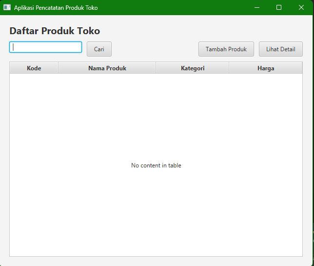
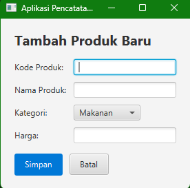
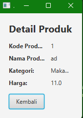

# Aplikasi Pencatatan Produk Toko (DaftarProdukApp)

Aplikasi desktop berbasis JavaFX untuk mencatat, mencari, dan melihat detail data produk toko (kategori **Makanan** dan **Minuman**) dengan penyimpanan data sementara di memori selama aplikasi berjalan.

## Fitur Utama
- **Tambah Produk**: Input kode produk, nama produk, kategori (`Makanan` / `Minuman`), dan harga dengan validasi (nama tidak boleh kosong dan harga harus lebih dari `0`).
- **Daftar Produk**: Menampilkan seluruh produk pada tabel (`Kode`, `Nama Produk`, `Kategori`, `Harga`).
- **Pencarian Produk**: Menyaring data tabel berdasarkan nama produk melalui tombol **Cari**.
- **Detail Produk**: Menampilkan informasi lengkap dari objek produk yang dipilih pada tabel.

## Prasyarat
- **JDK 17** atau lebih baru (pastikan `JAVA_HOME` mengarah ke JDK, bukan JRE)
- **Apache Maven**

## Cara Menjalankan Aplikasi
1. Buka terminal dan masuk ke folder proyek yang berisi file `pom.xml` (misalnya folder `DaftarProdukApp`).
2. Jalankan perintah berikut:
   ```bash
   mvn clean javafx:run
   ```

## Tampilan Aplikasi

### 1. Halaman Daftar Produk


### 2. Halaman Tambah Produk


### 3. Halaman Detail Produk
